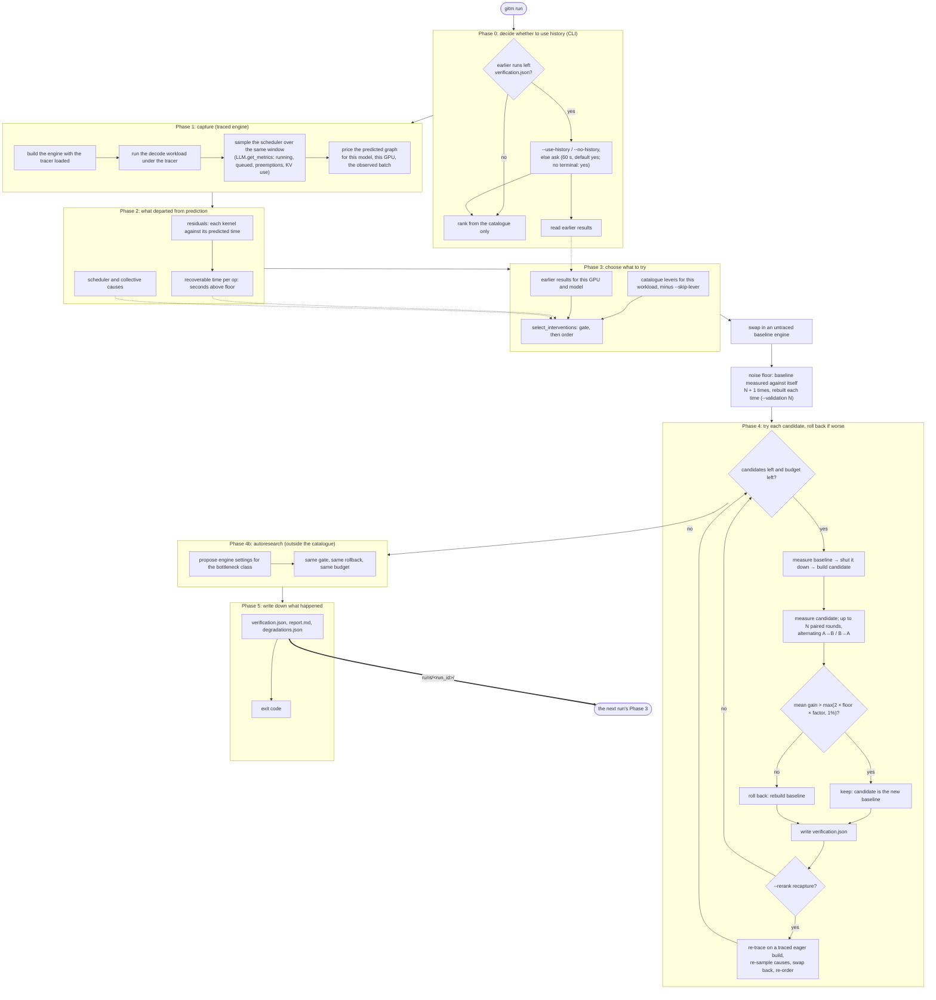

# The optimization loop

This page explains what `gitm run` does, phase by phase: where each decision gets its inputs, what each phase writes to disk, and the loop's known limits. It's for engineers who need to run the loop, read what it produced, or change it. The code is in `gitm/scheduler/loop.py`. This page links to the functions it describes rather than repeating them.

## In one paragraph

`gitm run` does six things:
1. Builds a vLLM engine and traces a decode workload on it.
2. Predicts how long each operation *should* take on this GPU (its floor).
3. Measures how far each operation is above that floor.
4. Ranks the interventions in its catalogue by what the run observed.
5. Tries them one at a time, each as an A/B test: baseline engine against candidate engine. It keeps a change only if it measured no worse, and rolls it back otherwise.
6. Writes a report and a `verification.json`, which the next run reads back.

Three things make it a loop rather than a pipeline:
- **Between runs:** each run's measured results rank the next run's candidates.
- **Within a run:** with `--rerank recapture`, each candidate's outcome re-orders the rest.
- **With a cluster:** `gitm propose` writes experiment arms for the cluster harness, and `gitm ingest` reads their results into the same history.

## The flow



## Phase by phase

### Phase 0: whether to use earlier results

If earlier runs left results, the CLI asks whether to rank this run from them, unless `--use-history` or `--no-history` was given.
- **It asks before anything starts,** so nobody is asked a question an hour into a run.
- **No answer within 60 seconds means yes,** and with no terminal attached it doesn't ask at all.
- **Nothing is deleted either way:** every run writes into its own `runs/<uuid>/`.
- **The question lives in the CLI, not the loop.** `gitm.optimize`, the embedded entry point, never reads stdin.

### Phase 1: capture

**The engine.** The `vllm-decode` workload (`gitm/workloads.py`) builds an offline `vllm.LLM` from environment variables:
- `GITM_VLLM_MODEL`, `GITM_VLLM_TP`, `GITM_VLLM_ENFORCE_EAGER`, `GITM_VLLM_MAX_MODEL_LEN`, …
- the workload size: `GITM_VLLM_PROMPTS` × `GITM_VLLM_MAX_TOKENS`, 256 × 512 by default. A much shorter decode (the old 64 × 128 took about 1.4 s) finishes before the tracer flushes anything.

**Before the engine is built,** a collective health check runs an AllReduce across the visible GPUs (skipped with fewer than 2). It detects the GPUs in a separate process: initialising CUDA in gitm's own process would stop vLLM from forking its engine.

**The tracer** is loaded into this opening engine only.
- On NVIDIA it's CUPTI, via `CUDA_INJECTION64_PATH`. On AMD it's rocprofiler-sdk, via `ROCP_TOOL_LIBRARIES`.
- The driver reads these once, when a process starts using the GPU. So they must be exported before `gitm run` starts; nothing can add them to a running engine.
- On AMD the engine workers start with spawn rather than fork: a forked worker keeps the GPU runtime but loses the profiler.
- **On AMD, run the opening capture eager** (`GITM_VLLM_ENFORCE_EAGER=1`). rocprofiler's queue interposition can deadlock against graph replay. It's a ROCm bug (vLLM #56506, ROCm #11623), and this setting avoids it.

**The scheduler** is sampled over the same window through `LLM.get_metrics()`. On vLLM 0.30 the scheduler runs in a separate EngineCore process, so its state is only visible there. It records:
- running and queued requests;
- preemptions;
- KV-cache usage.

**The predicted graph** comes from the model that actually ran, read off the live engine:
- dense, sparse mixture-of-experts, hybrid, or MLA-plus-MoE (the `glm_moe_dsa` family, which also covers Kimi K2.5 and K2.6);
- for the detected GPU (NVML, then torch, then `GITM_GPU_SKU`);
- at the batch the scheduler observed.

If any of these falls back to a default, that's recorded as a degradation, and the floors aren't used to gate anything.

### Phase 2: what departed from prediction

- **`residuals()`** pairs each kernel launch with the prediction for that launch.
- **`recoverable_by_op`** sums, per op, the time spent above its floor. It needs no step count. An op that can't be judged is reported as `None`, not as zero.
- **Scheduler causes** come from the sampled stats: an under-filled batch, queuing, preemptions, KV-cache pressure. **Collective causes** come from the trace. Each cause names the engine settings it argues for.
- **Granger and doubly-robust attribution** are computed and reported. Nothing in Phase 3 reads them.

### Phase 3: choose what to try

`select_interventions` (`gitm/agents/policy.py`) first rejects levers, then orders what's left by a fixed precedence. It never blends these into one score.

1. **Rejected.** A lever is rejected if:
   - it doesn't apply to this engine or GPU (vendor, GPU count, collectives, prerequisites);
   - it's excluded by `--skip-lever` / `GITM_SKIP_LEVERS`;
   - every op it works by speeding up is already at its floor.
2. **A known loser.** Its measured result, or its estimate, is ≤ 0.
3. **Demoted.** Its history both won and lost, so the lever behaves differently under conditions the record doesn't capture.
4. **Motivated by an observed cause.** A scheduler or collective cause in this run argues for one of its settings. Recorded as `motivated_by`.
5. **Aimed at lost time.** For a lever that works by speeding up specific ops: the seconds those ops spent above their floor, most first. Ops under 1% of device time don't count. Recorded as `targets`.
6. **The estimate, then the name.** With history on, the estimate is the lever's measured result on this GPU and model; otherwise it's the catalogue's own estimate.

Levers that reshape the whole step (graph capture, batch size) aren't aimed at any op, so they reach the front only through an observed cause.

**When the floors aren't priced for this run** (a default graph, or unknown GPU peaks), nothing is gated or ordered on lost time, and `targets.json` says why.

### Phase 4: try each candidate, roll back if worse

**The A/B.** `LiveEngineApplicator` (`gitm/optimizer/apply.py`) runs each candidate in serial mode:
1. Measure the baseline engine's decode throughput.
2. Shut it down.
3. Build the candidate with the whole GPU.
4. Measure the candidate.
5. Keep it, or roll back by rebuilding the baseline.

Only one engine is ever on the GPU. Parallel mode, where both are resident, is used only for engines that can't rebuild a baseline, and it refuses a candidate that won't fit.

**Kept changes stack.** A kept candidate becomes the baseline for the next one, so the run measures the combination it would actually deploy. It also means a lever's result depends on what was kept before it.

**No A/B engine carries the tracer.** After the opening capture, the traced engine is replaced by an untraced baseline, and every candidate is built untraced too. That keeps tracer overhead off one side of the comparison, and keeps the AMD deadlock's trigger out of every engine that replays graphs.

**Failures don't freeze or crash the run.**
- **A hang:** a build or decode that runs past its deadline is killed (`GITM_BUILD_TIMEOUT_S`, default 3600; `GITM_DECODE_TIMEOUT_S`, default 1800). If killing frees nothing, the call is abandoned 60 s later.
- **A failed candidate** is rolled back.
- **A baseline that can't be rebuilt:**
  - candidates stop, and the run records "engine lost";
  - the report is still written;
  - the run exits 5.
- **Results are saved as they happen:** `verification.json` is rewritten after every A/B, so a run that's killed keeps what it measured.

**Re-ranking** (`--rerank recapture`):
1. After each candidate, the loop swaps to a traced eager build of the current configuration.
2. It re-traces and re-samples the scheduler.
3. It swaps back to an untraced engine and re-orders what's left. Causes always come from the re-trace.
4. Lost time is used again only while the engine still has the settings the floors were priced for, and runs within 10% of the priced batch. Otherwise the floors describe a different engine, and the step records why it didn't use them.

**The keep rule: beat this run's own noise** (`--validation N`, default 2, or `GITM_VALIDATION`).
1. **The run measures its noise.** Before the first candidate, the baseline is measured N + 1 times, rebuilt each time. Each pair is an A/A sample: the same configuration on two builds. Every later re-measurement of the same baseline on a fresh build (after a rollback, or between rounds) adds another sample. The floor is the RMS of the samples. Calibration runs only with an engine-owned throughput probe, and within the budget.
2. **Each candidate gets up to N paired rounds.** The order alternates (A then B, then B then A), so drift within a round cancels, and each extra round costs one build because the running engine is measured again. A clear loss stops after round 1. Hot-swapped and parallel-restart candidates get their rounds too, measured in place.
3. **It's kept only if the mean of the rounds' B/A ratios beats `max(2 × floor × factor, minimum effect)`:**
   - the factor is the exact noise of that mean, since neighbouring rounds share a build (two rounds give 0.87, not 1/√2);
   - the minimum effect is `GITM_MIN_EFFECT`, 1% by default;
   - until the first A/A sample exists, the threshold is 2%.
4. **Autoresearch candidates always get at least 2 rounds:** it tries many guesses, so a lucky single A/B is likelier there.

On an RTX 4050 (Qwen2.5-0.5B, 256 × 512), identical builds differ by about 0.45%, so the threshold is about 1%. The previous rule, "keep if ≥ 0", kept 8 of 15 changes that did nothing.

### Phase 4b: autoresearch

Proposes engine settings outside the catalogue, aimed at the classified bottleneck and the op with the largest residual. It skips settings that can't move decode speed (offload, multimodal, safetensors, metrics). Every proposal goes through the same gate, the same rollback and the same budget as the catalogue. See `docs/autoresearch.md`.

### Phase 5: write down what happened

- **`verification.json`:** for each lever, the measured speedup, its rounds, the threshold it had to beat and the noise floor that set it, keep or rollback, the GPU, and the full baseline and candidate engine settings.
- **`report.md`:**
  - claims backed by a measured A/B;
  - a candidate that never ran listed as a rejection, not a claim;
  - a headline that doesn't add separate A/Bs together.
- **Exit code:**

| Code | Meaning |
|---|---|
| 0 | Finished |
| 3 | Nothing was traced (no data). The run records `trace.empty` and says which cause it was: no tracer configured, a tracer no process loaded, or a workload too short to flush |
| 5 | The baseline engine was lost; the report covers what was tried |
| 6 | A live run measured no candidate |

## The cluster edge: `gitm propose` and `gitm ingest`

- **`gitm propose`** ranks the catalogue against a baseline capture and writes `experiments.json`. It contains one arm per lever: the baseline's `vllm serve` command plus that one change, with the load shape and the levers it couldn't turn into arms.
- **`gitm ingest`** compares each finished arm with the baseline and files the result into the same history `gitm run` reads. It credits an arm to a lever only when the lever's setting is the only thing that changed.
- **Running the arms in between is manual today.** The harness doesn't read `experiments.json` directly.

## What a run writes

Everything lands in `$GITM_SCRATCH/runs/<run_id>/`.

| File | Phase | Holds |
|---|---|---|
| `scheduler_stats.json` | 1 | Scheduler samples and their summary |
| `predicted_graph.json` | 1 | Model family, GPU, batch used, node count |
| `residuals.json`, `deviations.json`, `deviation_trace.jsonl` | 2 | Observed against predicted |
| `history_read.json` | 3 | Which earlier runs were read and filtered, and on what |
| `ranked_candidates.json` | 3 | The order, rejection reasons, `motivated_by`, `targets` |
| `recoverable_ops.json` | 3 | Seconds above floor per op, or why the floors weren't used |
| `targets.json` | 3 | The ops losing the most time, the levers aimed at each, ops nothing is aimed at |
| `skipped_levers.json`, `restart_mode.json` | 3–4 | What `--skip-lever` excluded; which restart mode was used, and why |
| `tracing.json` | 4 | Which engines carried the tracer, and every swap |
| `rerank.json` | 4 | Each re-rank: order before and after, causes, whether lost time was used |
| `autoresearch.json` | 4b | Proposals, outcomes, why it stopped |
| `collective_health.json` | 0 | The GPU health check's result |
| `noise_floor.json` | 4 | The A/A samples, the floor, and the threshold for 1 round and for this run's validation level |
| `verification.json` | 4–5 | The A/B behind every claim |
| `degradations.json`, `report.md` | 5 | Every fallback the run took, and the summary |

## Running it

```bash
export CUDA_INJECTION64_PATH=...           # NVIDIA tracer, or ROCP_TOOL_LIBRARIES on AMD; before the run
export GITM_TRACE_OUT=/path/to/fresh.jsonl # a fresh path per capture: shared, two runs' shards mix
export GITM_VLLM_MODEL=Qwen/Qwen2.5-0.5B-Instruct
export GITM_VLLM_ENFORCE_EAGER=1           # required on AMD for the traced opening capture

gitm run --workload vllm-decode --budget 2h --rerank recapture --validation 2
```

Useful switches:

| Switch | Effect |
|---|---|
| `--no-history` / `--use-history` | Skip the question in Phase 0 |
| `--skip-lever PATTERN` | Exclude levers by name or setting (also `GITM_SKIP_LEVERS`) |
| `--validation N` | Noise calibration pairs and paired rounds per candidate (default 2, also `GITM_VALIDATION`) |
| `GITM_MIN_EFFECT` | Smallest mean gain worth keeping (default 0.01) |
| `GITM_AB_REPS=N` | Decodes per side of each A/B (default 1) |
| `GITM_RESTART_MODE` | Force `serial` or `parallel`; serial is the default |
| `GITM_BUILD_TIMEOUT_S`, `GITM_DECODE_TIMEOUT_S` | Hang deadlines; 0 turns them off |

## Known limits

- **History from before the noise floor still counts.** Records from runs kept at "≥ 0" have no `threshold` field, and many of their wins are noise. With history on, they still feed the ranking.
- **An unstable build isn't re-measured.** A build whose own repeated decodes disagree badly is a symptom (a neighbour, throttling), but spotting it needs 2+ decodes per build, which doubles the A/B cost.
- **One candidate at a time, and validation costs builds.** In serial mode at the default `--validation 2`:
  - a winner costs three builds: the candidate, the baseline again for round 2, then the candidate again to leave it running;
  - a candidate that reaches round 2 and loses costs two;
  - a clear loss stops after round 1 and costs two, the candidate plus the baseline rebuilt by the rollback.

  The run also spends N + 1 baseline builds measuring its noise first. On Kimi K2.5 at TP=8, where a build takes minutes, plan on roughly one candidate an hour, or use `--validation 1` for a quicker, noisier pass.
- **The cluster round is manual.** The arms `gitm propose` writes have to be turned into harness jobs, launched and collected by hand. Each arm has one traffic point, and `gitm ingest` reads throughput only.
- **Engine settings aren't priced.** The predicted graph depends on the model, the GPU and the batch, never on tensor parallelism, KV-cache dtype or quantization settings. Production extras like a speculative draft model aren't modelled either.
- **Attribution beyond residuals isn't acted on.** Granger and doubly-robust results are reported, but they don't affect the ranking.
